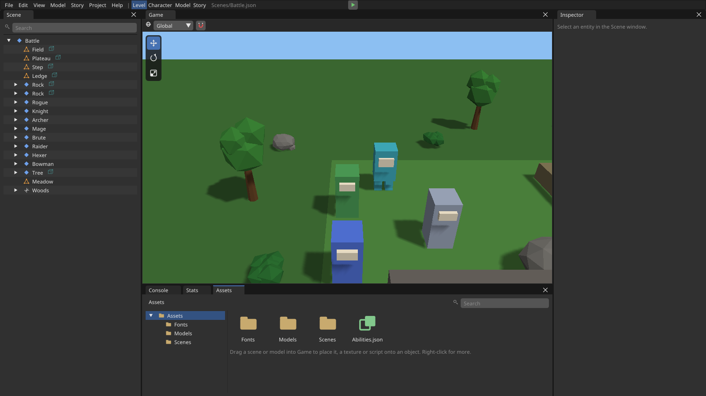
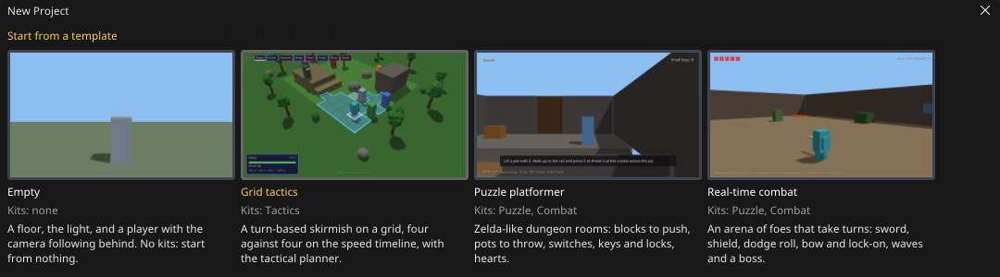
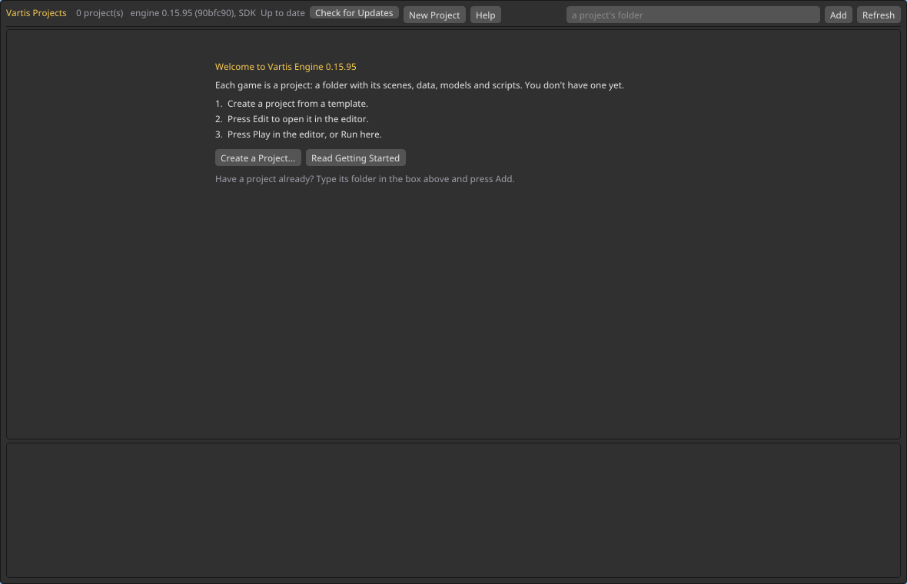

# Vartis Engine

An RPG engine with its own editor, made by **vartis3**: tactics battles,
action combat, puzzles and story, built in C++, JSON and Lua, with a
PlayStation-style look.

This repository holds the engine's **releases** - the installers - and
their notes. The engine's source isn't public.



## What's in it



- **The Project Manager** - your projects, a gallery of templates to start
  from, Play and Open.
- **The editor** - levels (place, move, undo, prefabs), a **Character**
  workspace (stats, skills, its look on a turntable, Try in Battle), a
  modeller, a **Story** menu (chapters, dialogue, cutscenes), Blender files
  brought in by themselves, data files edited as forms, Lua scripts with
  autocomplete in VS Code.
- **Kits** - Tactics (grid battles on a speed timeline), Combat (sword,
  shield, bow), Puzzle (push, pull, carry, keys), Story (chapters, flags,
  dialogue and staging).

## Installing (Pop!_OS, Ubuntu, Linux Mint)

1. Open the newest release on the right (**Releases**) and download
   `vartis-engine_<version>_amd64.deb`.
2. Double-click it: your system's installer opens with an **Install**
   button. It brings the C++ compiler and libraries games need with it.
   If it doesn't open, install it from a terminal:

   ```bash
   sudo apt install ./vartis-engine_*_amd64.deb
   ```

3. **Vartis Editor** is in your applications menu. The first time, it
   welcomes you: **Create a Project...** starts one from a template, and
   **Help** has the guides, readable without the internet.

   

Another Linux: take `VartisEngine-Installer-<version>-linux-x86_64.run`
and run it (`chmod +x` it first). Windows is planned.

**Updating:** the Project Manager tells you when there's a newer version:
a gold **Update to 0.x.y** button beside the engine's version. Press it,
then **Download and Install**: it downloads the new `.deb`, checks it
against the SHA-256 listed on this page, and installs it after your
password. Then **Restart Now**. Your projects are not changed.

**Removing:** `sudo apt remove vartis-engine` - your projects
(`~/VartisProjects`) are left as they are.

## Licence

The Vartis Engine is free to install and use to make games. All other
rights are reserved by its author. It's built with open-source libraries,
each under its own licence; their texts come with the engine
(`/opt/vartis/share/Vartis/Licenses`, and the `Licenses` folder of every
game it exports).
